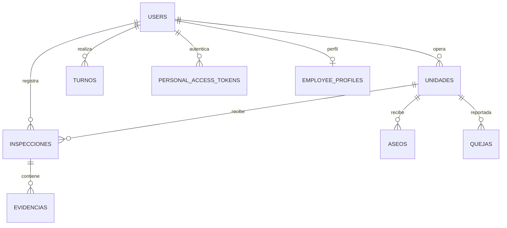

# RODAGEST — documentación técnica

## Arquitectura

Aplicación Laravel 12 con vistas Blade responsivas, controladores web bajo `app/Http/Controllers`, modelos Eloquent y MySQL 8. Las imágenes se guardan en el disco público de Laravel (`storage/app/public`) y se publican con `php artisan storage:link`. La autenticación web usa sesiones, CSRF y los middlewares `auth`, `active` y `role`. La API móvil usa Sanctum con tokens personales tipo Bearer.



## API móvil v1

Base URL: `/api/v1`. Enviar `Accept: application/json`; para fotos usar `multipart/form-data`. Respuestas: `{ "data": ..., "message": "..." }`; errores de validación devuelven JSON 422.

| Método | Endpoint | Acceso | Uso |
|---|---|---|---|
| POST | `/login` | Público, límite 5/min | Correo, contraseña, nombre de dispositivo y código TOTP cuando 2FA está activo. Devuelve token Sanctum una sola vez. |
| POST | `/logout` | Bearer | Revoca el token actual. |
| GET | `/unidades` | Admin, inspector, operador, limpieza | Lista paginada; los operadores solo ven sus unidades. |
| POST | `/inspecciones` | Inspector | Registra inspección, checklist y foto (`foto`, JPG/PNG/WebP hasta 5 MB). |
| GET/POST | `/reportes` | Operador | Lista los propios reportes / crea reporte con `eco`, `area`, `ruta_reportada`, tipo, urgencia, descripción y foto opcional; el ECO debe ser su unidad asignada. |
| GET/POST | `/aseos` | Limpieza | Lista paginada / registra proceso inicial con foto opcional. |

Enviar el token en `Authorization: Bearer <token>`. Los tokens vencen a los 30 días; el cliente móvil debe guardarlo en almacenamiento seguro del sistema operativo y revocarlo al cerrar sesión. Los endpoints de escritura aplican validación y restricciones por rol.

## Segundo factor (TOTP)

Cada usuario puede abrir **Seguridad 2FA** en la navegación, escanear el QR SVG generado localmente o ingresar la clave manual, y confirmar el alta con un código válido. La clave secreta se cifra con el cast `encrypted` de Laravel; requiere que `APP_KEY` permanezca estable y privada. El código tiene 6 dígitos y tolerancia de una ventana de 30 segundos. Al iniciar sesión web, el usuario activa primero su clave/contraseña y solo obtiene la sesión autenticada tras validar TOTP. En la app móvil, el código se envía durante `/login` cuando se solicita.

## Roles

- `admin`: panel, personal, flota, reportes y supervisión de incidencias.
- `inspector`: inspecciones y seguimiento de incidencias.
- `operador`: unidad asignada, turnos y reportes propios.
- `limpieza`: aseos y atención de reportes de limpieza.

Solo personal no administrador puede crear reportes internos o externos estando autenticado. El formulario público y el de trabajadores piden ECO y área por escrito; el ECO debe existir en la flota y los operadores solo pueden usar el económico de su unidad asignada. La cuenta `admin` solo consulta reportes y actualiza su estado/seguimiento. La recuperación por correo está bloqueada para `admin`; el administrador puede cambiar las claves de trabajadores desde el módulo Personal.

Las rutas web y API declaran roles explícitamente; los administradores no heredan automáticamente otros roles.

## Despliegue Docker

El `docker-compose.yml` original se conserva como entorno local de desarrollo (servidor Artisan, puerto localhost y MySQL de demostración). Para un servidor se añade `Dockerfile` basado en PHP-FPM, `Caddyfile` y `docker-compose.prod.yml`, que sirven la aplicación con Caddy/HTTPS, persisten MySQL y fotografías, y no publican el puerto de base de datos.

1. Copia `.env.example` a `.env`; establece `APP_KEY` con `docker compose exec -T laravel php artisan key:generate` en desarrollo o `php artisan key:generate --show` y copia el resultado al `.env` de producción.
2. Antes del despliegue, cambia `APP_DOMAIN`, `DB_USERNAME`, `DB_PASSWORD` y `MYSQL_ROOT_PASSWORD` por secretos fuertes diferentes. Define `APP_ENV=production`, `APP_DEBUG=false`; DNS del dominio debe apuntar al servidor y los puertos 80/443 deben estar disponibles para Caddy.
3. Construye e inicia con `docker compose -f docker-compose.prod.yml up -d --build`.
4. Aplica migraciones y limpia/compila caché: `docker compose -f docker-compose.prod.yml exec -T app php artisan migrate --force`, `... storage:link`, `... optimize:clear`, `... config:cache`.
5. Configura un worker persistente para trabajos en cola/notificaciones según el proveedor de correo. Haz respaldo de MySQL y `storage/app/public` antes de actualizar; conserva la misma `APP_KEY` para leer secretos TOTP cifrados.

El primer despliegue de producción usa volúmenes nuevos. No reutilices el volumen de datos del compose local con credenciales distintas sin planear la migración y rotación de la contraseña MySQL.

Para actualizar una instalación existente, conserva su `.env` y volúmenes: `git pull origin main`, `docker compose -f docker-compose.prod.yml up -d --build`, `docker compose -f docker-compose.prod.yml exec -T app php artisan migrate --force`, `docker compose -f docker-compose.prod.yml exec -T app php artisan optimize:clear` y `docker compose -f docker-compose.prod.yml exec -T app php artisan config:cache`. No vuelvas a copiar `.env.example` encima del `.env` ya configurado.

## Pruebas automatizadas

Ejecuta `docker compose exec -T laravel php artisan test` en desarrollo con Docker disponible. La suite incluye autenticación, acceso de los cuatro roles al dashboard, TOTP, validación de contraseñas de personal, restablecimiento fuerte y registro público deshabilitado. Las pruebas de persistencia que usan base real deben ejecutarse contra una BD de pruebas aislada, nunca contra datos de producción.

## Correo Gmail SMTP

En Gmail activa la verificación en dos pasos y crea una **contraseña de aplicación** para RODAGEST. No uses tu contraseña normal. Agrega al `.env`:

```dotenv
MAIL_MAILER=smtp
MAIL_SCHEME=tls
MAIL_ENCRYPTION=tls
MAIL_HOST=smtp.gmail.com
MAIL_PORT=587
MAIL_USERNAME=tu-cuenta@gmail.com
MAIL_PASSWORD=contraseña_de_aplicación_de_16_caracteres
MAIL_FROM_ADDRESS=tu-cuenta@gmail.com
MAIL_FROM_NAME="RODAGEST"
```

En local, si `MAIL_USERNAME` está vacío y no se define `MAIL_MAILER`, Laravel usa `log`; consulta `storage/logs/laravel.log` para ver el enlace. Para probar SMTP real corre `docker compose exec -T laravel php artisan optimize:clear` y solicita otro enlace.

## AWS Lightsail sin Cloudflare

El QR público y los QR individuales de ECO deben imprimirse después de desplegar el sistema con su URL pública definitiva. El QR de cada unidad abre `/reportar?eco=<ECO>` y precarga su número económico; los reportes y evidencias de seguimiento usan el dominio público de la aplicación.

Para producción se usa `docker-compose.prod.yml`, no el compose local de desarrollo. Se recomienda asociar una IP estática de Lightsail y apuntar un dominio propio con un registro DNS `A` a esa IP. En el firewall de Lightsail se permiten TCP 80 y 443 para el sitio; SSH se restringe a la IP del administrador, y no se abre MySQL (3306) a Internet. Caddy sirve HTTPS directamente, sin proxy de Cloudflare. Si se configura solo la IP pública, Caddy no puede emitir un certificado público de confianza para navegadores comunes; usar HTTP para un QR de quejas con fotos o datos de contacto no es adecuado para producción. Configura dominio y DNS antes de imprimir los QR.

En el servidor Ubuntu, clona el repositorio, copia `.env.example` a `.env`, genera secretos nuevos (`APP_KEY`, `DB_PASSWORD`, `MYSQL_ROOT_PASSWORD`), y configura `APP_DOMAIN`, `APP_URL`, `RODAGEST_PUBLIC_URL`, `APP_ENV=production`, `APP_DEBUG=false`, `DB_USERNAME` y las variables SMTP. No copies el `.env` local al repositorio ni reutilices contraseñas de desarrollo. Despliega con `docker compose -f docker-compose.prod.yml up -d --build`, luego aplica `migrate --force`, `storage:link`, `optimize:clear` y `config:cache` dentro del servicio `app`. Tras confirmar el dominio, genera/descarga los QR desde el panel y vuelve a imprimir los QR de unidades si ya existían.

**Rotación de credenciales:** las credenciales SMTP no deben estar en `.env.example` ni en Git. Si una contraseña de aplicación llegó a un commit, revócala en la cuenta de correo y crea otra antes de habilitar SMTP; editar el archivo no elimina el secreto del historial Git.

## Política de seguridad

- Mantener HTTPS en producción, `APP_DEBUG=false`, claves fuera del repositorio y cookies `Secure`, `HttpOnly`, `SameSite=Lax`.
- Rotar `APP_KEY` solo con un plan para volver a enrolar TOTP, pues los secretos cifrados dependen de esta clave.
- Contraseñas nuevas requieren mínimo 8 caracteres, mayúscula, minúscula, número y símbolo; login y recuperación tienen límites por IP.
- No almacenar tokens móviles sin cifrado en el dispositivo ni compartir exportaciones de datos sensibles.
- Mantener dependencias Composer actualizadas y revisar logs, accesos denegados y fallas de envío.
