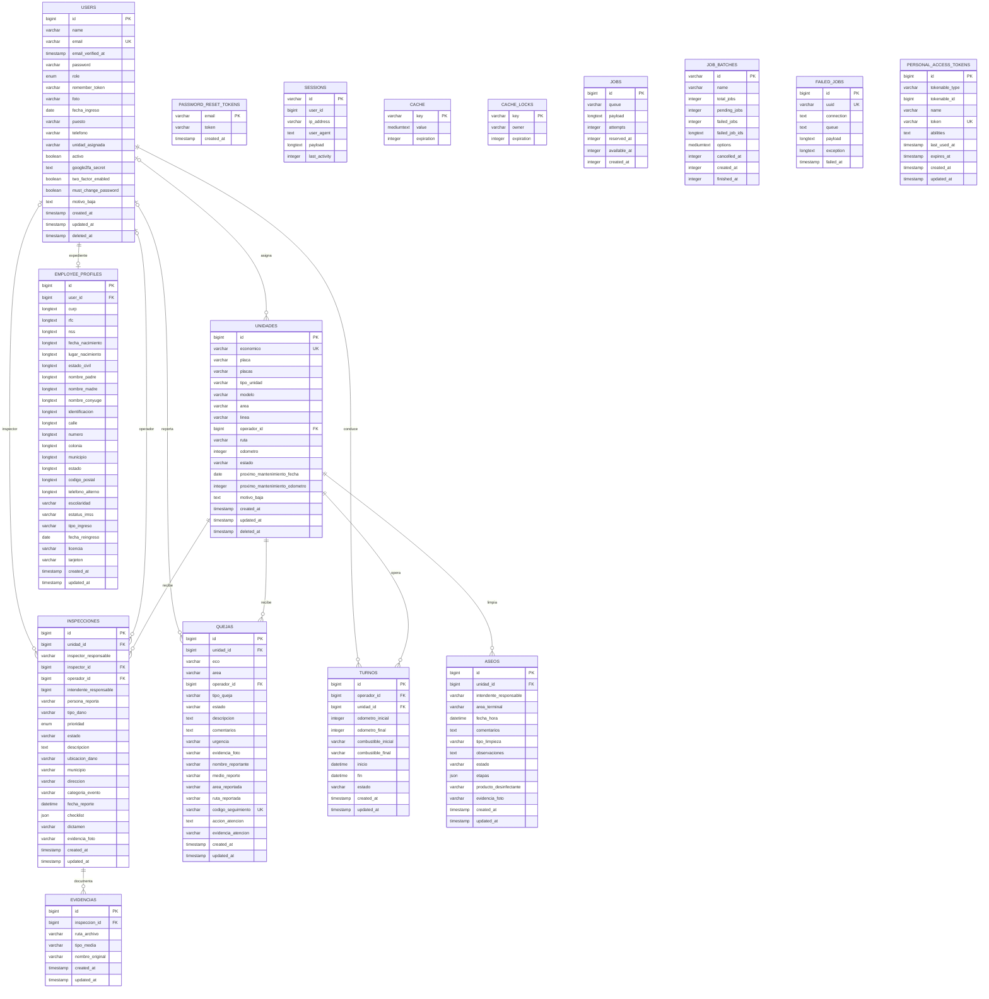
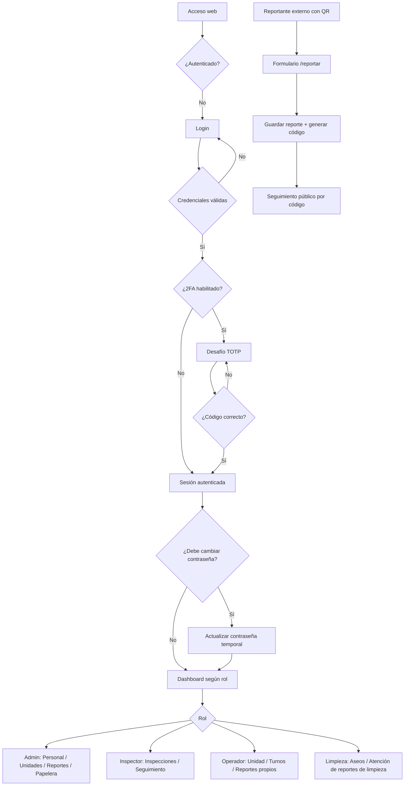
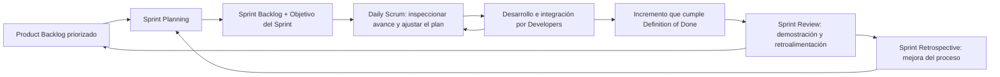
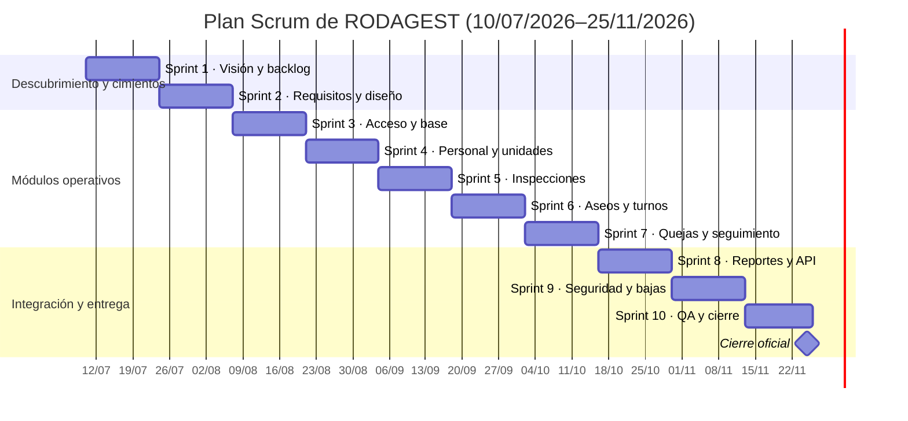
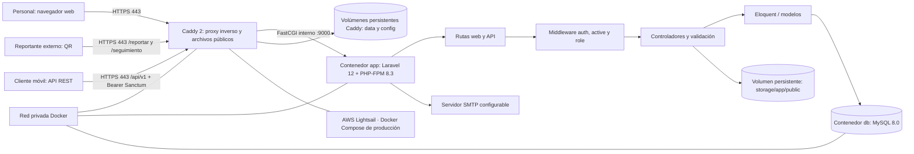
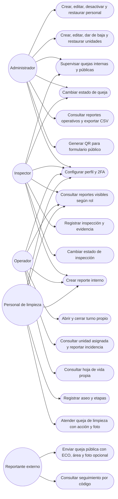
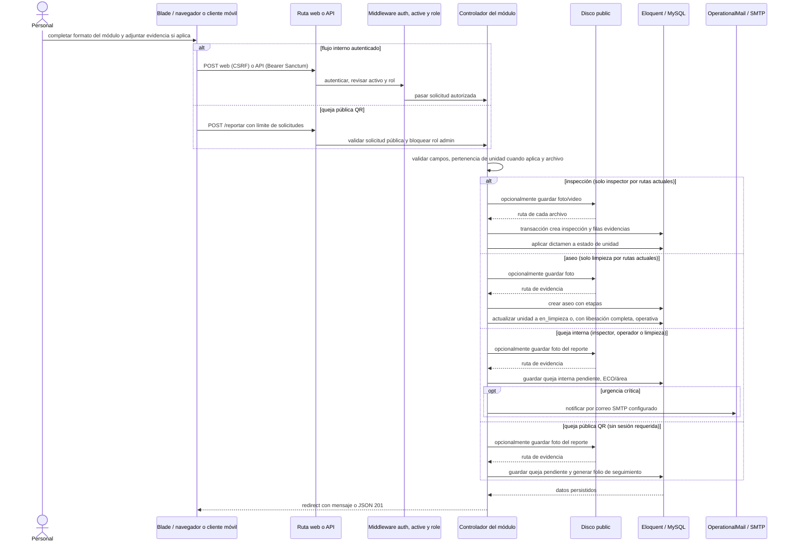
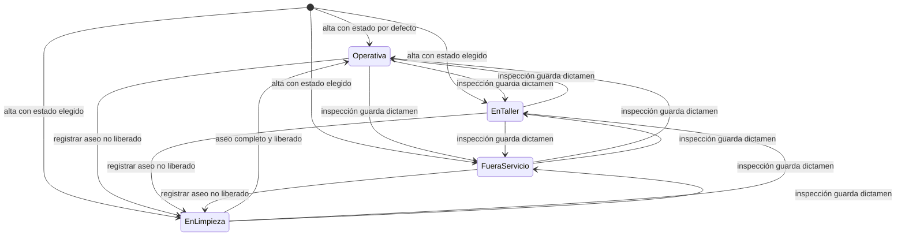
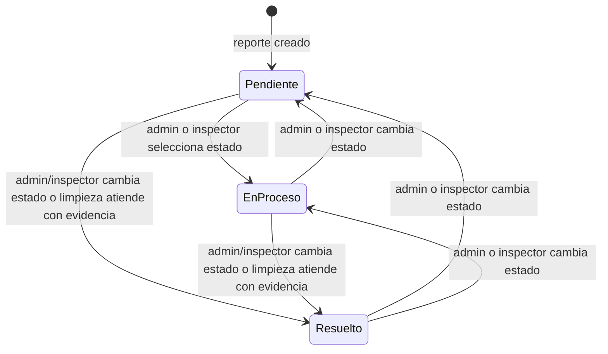
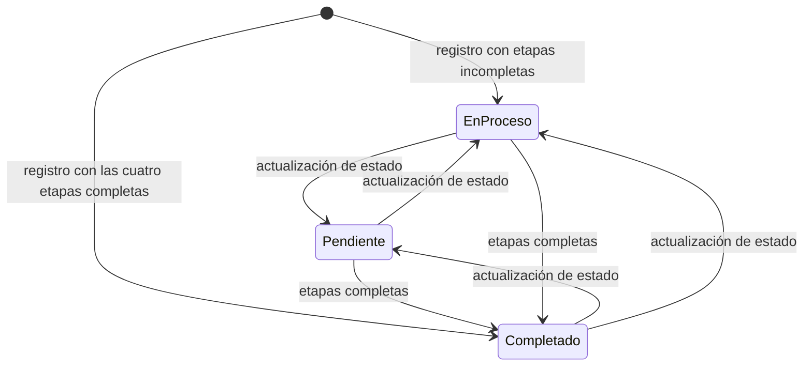

# UNIVERSIDAD POLITÉCNICA DE TEXCOCO

## DOCUMENTO TÉCNICO Y FUNCIONAL DEL PROYECTO

### RODAGEST
#### Sistema Web para la Gestión de Limpieza e Inspección de Daños en Unidades de la Línea 3 del Mexibús

**Autores:** Ibarra Hernandez Mayra Jozelin · Lara Velazquez Diego de Jesus  
**Programa académico:** [Completar de acuerdo con la portada oficial UPTex]  
**Asesor(a):** [Completar]  
**Texcoco, Estado de México**  
**Periodo del proyecto:** 10 de julio de 2026 – 25 de noviembre de 2026

> **Criterio de fidelidad documental.** Este documento se elaboró contrastando el código fuente, migraciones, controladores, rutas, modelos, pruebas automatizadas y configuración Docker del repositorio. La plantilla `plantilla9no_RODAGEST.docx` no se encuentra en la raíz ni dentro del repositorio analizado; por ello se proporciona el contenido con la estructura académica solicitada para copiarlo a la plantilla oficial. La fecha de corte de esta revisión es 23/11/2026. Los hitos posteriores a esa fecha se muestran como cierre programado, no como actividades verificadas.

---

# Capítulo 1. Planteamiento del proyecto

## 1.1. Introducción

La operación de una flota de transporte requiere registrar las condiciones de cada unidad, documentar fallas, programar labores de limpieza y dar seguimiento a los reportes de usuarios y personal. Cuando estas tareas se realizan en hojas de cálculo, mensajes dispersos o formatos físicos, la consulta del historial y la asignación de responsabilidades se vuelven más difíciles.

RODAGEST es una aplicación web desarrollada para concentrar información operativa relacionada con unidades de transporte: inspecciones de patio, aseos, turnos de operadores, quejas e incidencias, mantenimiento preventivo y datos del personal. El sistema ofrece interfaces diferenciadas por rol, persistencia mediante Eloquent y MySQL, captura de evidencias y una API REST versionada para clientes móviles.

## 1.2. Problemática

El proyecto atiende la necesidad de contar con registros centralizados y consultables para conocer la condición operativa de las unidades y las actividades realizadas por los equipos de inspección, conducción y limpieza. La aplicación relaciona los reportes con un número económico (ECO), permite agregar área y evidencia, y conserva información histórica al dar de baja lógicamente personal o unidades.

El sistema no reemplaza procedimientos de seguridad, mantenimiento especializado ni sistemas oficiales de operación del transporte. Funciona como herramienta de registro, consulta y seguimiento administrativo.

## 1.3. Objetivo general

Desarrollar e implementar un sistema web responsivo para registrar, consultar y dar seguimiento a las actividades de inspección, limpieza, operación y atención de incidencias de las unidades de la Línea 3 del Mexibús, con acceso controlado por roles y persistencia en una base de datos relacional.

## 1.4. Objetivos específicos

1. Implementar módulos de administración de unidades y personal, incluyendo asignación de operador, datos de ingreso, fotografía y expediente laboral.
2. Registrar inspecciones, aseos, turnos y reportes con estados operativos y evidencia digital.
3. Incorporar un flujo público de reportes por QR con captura manual de ECO y área, código de seguimiento y evidencia opcional.
4. Aplicar controles de acceso por rol, contraseña segura, cambio de contraseña temporal y segundo factor TOTP configurable por usuario.
5. Preparar el proyecto para ejecutarse mediante Docker Compose y un proxy Caddy con HTTPS automático cuando el dominio, DNS, almacenamiento persistente y puertos estén correctamente configurados.
6. Proporcionar endpoints REST autenticados con Sanctum para operaciones móviles implementadas en el repositorio.

## 1.5. Alcance

El alcance del software implementado comprende:

- Autenticación de usuarios y perfiles asociados a cuatro roles (`admin`, `inspector`, `operador`, `limpieza`).
- Dashboard contextual por rol con métricas calculadas a partir de registros existentes.
- Alta, consulta, edición y baja lógica de unidades; ficha de unidad y avisos de mantenimiento preventivo.
- Administración de trabajadores, fotografías, filtros, asignación de unidad, contraseñas temporales y hoja de vida bajo demanda.
- Inspecciones con checklist, dictamen, estado, fecha y archivos de evidencia.
- Aseos asociados a unidad, etapas, producto, estado, observaciones y fotografía.
- Turnos de operador, con odómetro y combustible de inicio y fin.
- Quejas e incidencias internas y públicas; filtros, estado, urgencia, foto, folio de seguimiento y evidencia de atención.
- Papelera para restauración de unidades y empleados dados de baja lógicamente.
- Configuración de 2FA TOTP con código QR local/SVG producido por dependencias PHP del proyecto.
- API `/api/v1` con login de token, unidades, inspecciones, reportes de operador y aseos.
- Configuración de despliegue productivo en tres contenedores (`app`, `db`, `caddy`) y volúmenes Docker persistentes.

## 1.6. Limitaciones y precisiones

- El repositorio no contiene un cliente móvil Flutter, React Native o Android; contiene endpoints para integración móvil.
- La API tiene operaciones de alta y consulta, pero no presenta CRUD completo de todos los recursos ni una respuesta uniforme para todos los errores de validación más allá del formato JSON estándar de Laravel.
- El estado real de AWS Lightsail, DNS, disponibilidad pública del dominio, certificados emitidos, credenciales SMTP y salud de producción no puede deducirse exclusivamente del código. El README declara `https://rodagest.duckdns.org/`; el Caddyfile utiliza el valor dinámico `APP_DOMAIN`.
- La unicidad del rol administrador se valida en la lógica del controlador y en una prueba; no existe índice único condicional en la base de datos que la garantice ante escrituras externas/concurrentes.
- 2FA está disponible para activación individual y su valor inicial es `false`; no está forzado para todo el personal.
- La contraseña temporal no tiene fecha de vencimiento. El indicador obliga a cambiarla al iniciar sesión por primera vez o después de que el administrador la restablece.
- La hoja de vida incluye campos personales cifrados a nivel de modelo, pero el sistema no sustituye un expediente de Recursos Humanos con firma digital o control documental normativo.
- La ejecución de `php artisan test`, `php artisan view:clear` y `npm run build` en el entorno de auditoría quedó bloqueada por dependencias locales incompletas (Sanctum y un paquete binario opcional de Rollup). Los casos de prueba existentes no se reportan como aprobados hasta correrlos en un entorno íntegro.
- La política de `fecha_ingreso >= 2026-01-01` se encuentra validada actualmente en el controlador; su correspondencia con una política institucional debe confirmarse con la universidad/empresa.

## 1.7. Usuarios del sistema

| Rol | Responsabilidad principal | Permisos característicos |
|---|---|---|
| `admin` | Administración y supervisión | Personal, unidades, reportes operativos, papelera, seguimiento de reportes y QR público. No crea quejas internas ni accede al formulario público estando autenticado. |
| `inspector` | Inspección de patio | Registro e historial de inspecciones, cambio de estado de inspección, consulta y seguimiento de quejas. |
| `operador` | Operación de unidad | Consulta de unidad asignada, apertura/cierre de turno, consulta y creación de reportes ligados a su unidad. |
| `limpieza` | Limpieza de flota | Registro y actualización de aseos, atención de reportes de tipo limpieza con descripción y evidencia. |
| Público | Reportante externo sin cuenta | Registro de reporte por `/reportar` y consulta de seguimiento por código. Las rutas públicas tienen límites por tasa. |

---

# Capítulo 2. Marco tecnológico y diseño

## 2.1. Stack tecnológico detectado

| Componente | Versión/configuración detectada | Evidencia en el repositorio |
|---|---|---|
| PHP | `^8.2` en Composer; imagen de producción `php:8.3-fpm-bookworm` | `composer.json`, `Dockerfile` |
| Laravel | Framework `^12.0`; lock auditado `v12.64.0` | `composer.json`, `composer.lock` |
| MySQL | `mysql:8.0` | `docker-compose.yml`, `docker-compose.prod.yml` |
| Laravel Sanctum | `^4.0`; lock `v4.5.0` | Composer y API |
| Google2FA Laravel | `^2.3`; lock `v2.3.1` | Composer, `TwoFactorController` |
| Bacon QR Code | `^3.0` | Composer; generación SVG de QR |
| Node.js | No fijado en archivos del proyecto | Sin `.nvmrc`/engines identificados |
| Vite | Declarado `^7.0.7`; lock `7.3.6` | `package.json`, `package-lock.json` |
| Laravel Vite Plugin | lock `2.1.0` | `package-lock.json`, `vite.config.js` |
| Tailwind CSS | Declarado `^3.1.0`; lock `3.4.19` | `package.json`, CSS con directivas Tailwind v3 |
| `@tailwindcss/vite` | Declarado `^4.0.0`; lock `4.3.3` | `package.json`, `package-lock.json` |
| Alpine.js | Declarado `^3.4.2`; lock `3.15.12` | `package.json`; uso depende de vistas |
| Docker | Dockerfile PHP-FPM y Compose | Dockerfile y dos archivos Compose |
| Docker Compose | Sintaxis Compose v2; versión del ejecutable no fijada | `docker-compose*.yml` |
| Caddy | Imagen `caddy:2-alpine` | `docker-compose.prod.yml`, `Caddyfile` |

> **Nota de compatibilidad frontend:** el manifiesto combina Tailwind 3 con `@tailwindcss/vite` versión 4. El `vite.config.js` actual registra el plugin de Laravel Vite, no el plugin Tailwind v4; `resources/css/app.css` usa las directivas `@tailwind base/components/utilities` de Tailwind 3. Debe homologarse esa combinación para que la compilación sea reproducible. La vista dashboard aún puede cargar Tailwind por CDN, por lo que la apariencia no depende exclusivamente de `npm run build`.

## 2.2. Arquitectura MVC

RODAGEST utiliza el patrón Modelo–Vista–Controlador de Laravel:

1. **Rutas** (`routes/web.php`, `routes/api.php`) definen URI, verbo HTTP y controlador.
2. **Middleware** verifica autenticación (`auth` / Sanctum), estado activo (`active`), roles (`role`), límites de solicitudes (`throttle`) y añade encabezados de seguridad.
3. **Controladores** validan entradas y coordinan reglas operativas; los formularios complejos reutilizan Form Requests.
4. **Modelos Eloquent** encapsulan atributos, casts, relaciones y borrado lógico.
5. **Vistas Blade** generan HTML responsivo y muestran formularios, tablas, mensajes y dashboards.
6. **Base relacional** persiste datos; Laravel Filesystem guarda evidencias y fotos en el disco `public` cuando así está configurado.

## 2.3. Arquitectura de despliegue configurada

El archivo `docker-compose.prod.yml` define tres servicios dentro de una red privada:

- `app`: imagen PHP-FPM 8.3, extensión PDO MySQL, Composer en build, `storage:link`, ejecuta FPM en puerto interno 9000 y conserva `/app/storage` en volumen.
- `db`: MySQL 8.0 con volumen de datos y healthcheck. No publica el puerto 3306 al exterior.
- `caddy`: proxy inverso público que expone 80/TCP, 443/TCP y 443/UDP; sirve `public/`, archivos de `storage` y reenvía PHP a `app:9000`. Los datos de Caddy se conservan en volúmenes.

La provisión de HTTPS automático por Caddy requiere DNS A/AAAA apuntando al servidor, acceso entrante a puertos 80/443 y almacenamiento de Caddy persistente. El repo soporta un host definido por `APP_DOMAIN`. El README identifica `https://rodagest.duckdns.org/` como URL de producción declarada; esta auditoría no hizo una solicitud HTTP/HTTPS al sitio, ni comprobó DNS, estado de instancia o reglas de firewall en AWS Lightsail.

## 2.4. Modelo de datos

### Diagrama Entidad–Relación



*Figura 1. Diagrama entidad–relación de RODAGEST. Fuente: elaboración propia con base en las migraciones y relaciones Eloquent del repositorio.*

La relación `EMPLOYEE_PROFILES.user_id` está declarada como FK y es `UNIQUE`, por lo que cada usuario tiene como máximo un expediente. `SESSIONS.user_id` y `PERSONAL_ACCESS_TOKENS.tokenable_id` son índices, no llaves foráneas declaradas: la primera no tiene `constrained()` y la segunda forma parte de la relación polimórfica de Sanctum (`tokenable_type`, `tokenable_id`). `INSPECCIONES.intendente_responsable` es un `BIGINT` histórico sin FK declarada; no se dibuja como relación. `UNIDADES.placa` y `UNIDADES.placas` son columnas distintas existentes por evolución del esquema. `QUEJAS.operador_id`, `QUEJAS.eco` y `QUEJAS.area` permiten NULL para compatibilidad con reportes públicos/históricos, aunque los formularios actuales los validan. La FK `UNIDADES.operador_id` es nullable; las FKs `unidad_id` de inspecciones, aseos, quejas y turnos son obligatorias según sus migraciones. La tabla `migrations` la crea el repositorio de migraciones de Laravel durante la instalación y no aparece como `Schema::create` en los archivos de migración de la aplicación.

### Diccionario de datos

Los tipos reflejan el tipo lógico definido por las migraciones Laravel; el tipo SQL físico concreto depende del motor/versión. `timestamps` corresponde a `created_at` y `updated_at`; `softDeletes` a `deleted_at` anulable.

#### `users`

| Campo | Tipo | Restricciones | Descripción |
|---|---|---|---|
| id | BIGINT UNSIGNED | PK, autoincremental | Identificador de usuario. |
| name | VARCHAR(255) | NOT NULL | Nombre visible. |
| email | VARCHAR(255) | NOT NULL, UNIQUE | Usuario de acceso y destino de avisos. |
| email_verified_at | TIMESTAMP | NULL | Marca de verificación de correo. |
| password | VARCHAR(255) | NOT NULL | Hash de contraseña Laravel. |
| role | ENUM/string | NOT NULL, DEFAULT `operador` | `admin`, `inspector`, `operador` o `limpieza`; algunas migraciones existentes usan string al completar instalaciones previas. |
| remember_token | VARCHAR(100) | NULL | Persistencia de sesión “recordarme”. |
| foto | VARCHAR(255) | NULL | Ruta pública de foto de empleado. |
| fecha_ingreso | DATE | NULL | Fecha de alta. |
| puesto | VARCHAR(255) | NULL | Puesto laboral. |
| telefono | VARCHAR(255) | NULL | Teléfono de contacto. |
| unidad_asignada | VARCHAR(255) | NULL, legado | Columna inicial de perfil; la asignación actual se modela en `unidades.operador_id`. |
| activo | BOOLEAN | DEFAULT true | Habilita o bloquea acceso. |
| google2fa_secret | TEXT | NULL, cifrado por cast | Secreto TOTP cifrado a nivel de aplicación. |
| two_factor_enabled | BOOLEAN | DEFAULT false | Habilita segundo factor si el usuario lo activa. |
| must_change_password | BOOLEAN | DEFAULT false | Obliga a cambiar contraseña al siguiente acceso. No contiene caducidad. |
| motivo_baja | TEXT | NULL | Justificación de baja. |
| created_at, updated_at | TIMESTAMP | NULL según convención Laravel | Auditoría temporal. |
| deleted_at | TIMESTAMP | NULL | Borrado lógico. |

#### `unidades`

| Campo | Tipo | Restricciones | Descripción |
|---|---|---|---|
| id | BIGINT UNSIGNED | PK | Identificador. |
| economico | VARCHAR(255) | NOT NULL, UNIQUE | ECO de flota. La validación de formulario limita a 20 caracteres. |
| placa / placas | VARCHAR(255) | NULL | Columna histórica; conviven nombres en migraciones. No se solicita placa en captura actual. |
| tipo_unidad | VARCHAR(255) | NULL | Clasificación histórica. |
| modelo | VARCHAR(255) | NULL | Modelo; la actualización se valida como inmutable. |
| area | VARCHAR(255) | NULL | Área o terminal. |
| linea | VARCHAR(255) | NULL | Dato histórico de línea. |
| operador_id | BIGINT UNSIGNED | NULL, FK → users.id, `nullOnDelete` | Operador actualmente asignado. |
| ruta | VARCHAR(255) | NULL | Ruta asignada; existe en API/datos aunque no siempre se presenta en formularios. |
| odometro | INT UNSIGNED | NULL | Lectura actual de odómetro. |
| estado | VARCHAR(255) | DEFAULT `activo` en migración de compatibilidad | Normalización convierte registros `activo`→`operativa` y `mantenimiento`→`en_taller`; flujos actuales usan `operativa`, `en_taller`, `en_limpieza`, `fuera_servicio`. |
| proximo_mantenimiento_fecha | DATE | NULL | Umbral de mantenimiento preventivo por fecha. |
| proximo_mantenimiento_odometro | INT UNSIGNED | NULL | Umbral de mantenimiento por kilometraje. |
| motivo_baja | TEXT | NULL | Motivo de envío a papelera. |
| created_at, updated_at | TIMESTAMP | — | Auditoría. |
| deleted_at | TIMESTAMP | NULL | Baja lógica. |

#### `inspecciones`

| Campo | Tipo | Restricciones | Descripción |
|---|---|---|---|
| id | BIGINT UNSIGNED | PK | Identificador. |
| unidad_id | BIGINT UNSIGNED | FK → unidades.id, inicial `ON DELETE CASCADE` | Unidad inspeccionada. |
| inspector_responsable | VARCHAR(255) | NOT NULL | Nombre del inspector capturado. |
| intendente_responsable | BIGINT UNSIGNED | NULL, columna heredada sin FK declarada | Identificador añadido por una migración histórica; no forma parte del modelo Eloquent actual `Inspeccion`. |
| inspector_id | BIGINT UNSIGNED | NULL, FK → users.id, `nullOnDelete` | Inspector relacionado. |
| operador_id | BIGINT UNSIGNED | NULL, FK → users.id, `nullOnDelete` | Operador relacionado cuando aplica. |
| persona_reporta | VARCHAR(150) | NULL | Persona que detectó la falla. |
| tipo_dano | VARCHAR(255) | NOT NULL | Categoría de daño o hallazgo. |
| prioridad | ENUM | DEFAULT `media`; `baja`, `media`, `alta`, `critica` | Severidad. |
| estado | VARCHAR/ENUM | DEFAULT `pendiente` | El flujo actual valida `pendiente`, `en_proceso`, `resuelto`; una migración previa convirtió registros `resuelto` a `reparada`. |
| descripcion | TEXT | NOT NULL | Descripción del hallazgo. |
| ubicacion_dano | VARCHAR(180) | NULL | Zona del daño. |
| municipio | VARCHAR(120) | NULL | Municipio. |
| direccion | VARCHAR(255) | NULL | Dirección/ubicación. |
| categoria_evento | VARCHAR(80) | NULL | Clasificación del evento. |
| fecha_reporte | DATETIME | NOT NULL | Fecha de inspección. |
| checklist | JSON | NULL | Respuestas estructuradas a revisión. |
| dictamen | VARCHAR(255) | DEFAULT `operativa` | Dictamen de operación. |
| evidencia_foto | VARCHAR(255) | NULL | Ruta de evidencia principal opcional. |
| created_at, updated_at | TIMESTAMP | — | Auditoría. |

#### `evidencias`

| Campo | Tipo | Restricciones | Descripción |
|---|---|---|---|
| id | BIGINT UNSIGNED | PK | Identificador. |
| inspeccion_id | BIGINT UNSIGNED | FK → inspecciones.id, `ON DELETE CASCADE` | Inspección relacionada. |
| ruta_archivo | VARCHAR(255) | NOT NULL | Ruta del archivo en almacenamiento. |
| tipo_media | VARCHAR(12) | DEFAULT `imagen` | Tipo de archivo multimedia. |
| nombre_original | VARCHAR(255) | NULL | Nombre original al cargar. |
| created_at, updated_at | TIMESTAMP | — | Auditoría. |

#### `aseos`

| Campo | Tipo | Restricciones | Descripción |
|---|---|---|---|
| id | BIGINT UNSIGNED | PK | Identificador. |
| unidad_id | BIGINT UNSIGNED | FK → unidades.id, inicial `ON DELETE CASCADE` | Unidad atendida. |
| intendente_responsable | VARCHAR(255) | NULL en esquema ampliado | Responsable del aseo. |
| area_terminal | VARCHAR(255) | NOT NULL en creación original | Terminal o zona de trabajo. |
| fecha_hora | DATETIME | NOT NULL | Fecha de registro. |
| comentarios | TEXT | NULL | Comentario inicial. |
| tipo_limpieza | VARCHAR(255) | NULL | Lavado/desinfección capturada. |
| observaciones | TEXT | NULL | Observaciones ampliadas. |
| estado | VARCHAR(255) | DEFAULT `completado` en migración de compatibilidad | `pendiente`, `en_proceso`, `completado` según flujos. |
| etapas | JSON | NULL | Etapas de limpieza completadas. |
| producto_desinfectante | VARCHAR(255) | NULL | Producto aplicado. |
| evidencia_foto | VARCHAR(255) | NULL | Ruta de evidencia. |
| created_at, updated_at | TIMESTAMP | — | Auditoría. |

#### `quejas`

| Campo | Tipo | Restricciones | Descripción |
|---|---|---|---|
| id | BIGINT UNSIGNED | PK | Identificador. |
| unidad_id | BIGINT UNSIGNED | FK → unidades.id | Unidad reportada; permite consulta de unidad dada de baja desde relaciones con `withTrashed`. |
| operador_id | BIGINT UNSIGNED | NULL, FK → users.id, `nullOnDelete` | Autor operador; nullable para reportes externos. |
| eco | VARCHAR(30) | NULL en migración; requerido por validación web | ECO ingresado manualmente y conservado como texto. |
| area | VARCHAR(80) | NULL en migración; requerido por validación web | Área capturada manualmente. |
| tipo_queja | VARCHAR(255) | NOT NULL | Tipo: limpieza, falla mecánica, ruta, seguridad u otro. |
| estado | VARCHAR(255) | DEFAULT `pendiente` | `pendiente`, `en_proceso`, `resuelto`. |
| descripcion | TEXT | NOT NULL | Descripción. |
| comentarios | TEXT | NULL | Comentarios de seguimiento. |
| urgencia | VARCHAR(255) | DEFAULT `normal` | Normal, alta o crítica. |
| evidencia_foto | VARCHAR(255) | NULL | Evidencia original. |
| nombre_reportante | VARCHAR(120) | NULL | Nombre declarado en formulario público. |
| medio_reporte | VARCHAR(20) | DEFAULT `interno` | `interno`, `qr`, `app` y valores heredados normalizados. |
| area_reportada | VARCHAR(80) | NULL | Área conservada para compatibilidad/historial. |
| ruta_reportada | VARCHAR(120) | NULL | Lugar/ruta complementario; la vista interna actual puede omitirlo. |
| codigo_seguimiento | VARCHAR(32) | NULL, UNIQUE | Folio aleatorio para consulta pública. |
| accion_atencion | TEXT | NULL | Acción realizada por limpieza. |
| evidencia_atencion | VARCHAR(255) | NULL | Foto de atención. |
| created_at, updated_at | TIMESTAMP | — | Auditoría. |

#### `turnos`

| Campo | Tipo | Restricciones | Descripción |
|---|---|---|---|
| id | BIGINT UNSIGNED | PK | Identificador del turno. |
| operador_id | BIGINT UNSIGNED | FK → users.id, cascade en creación | Operador. |
| unidad_id | BIGINT UNSIGNED | FK → unidades.id, cascade en creación | Unidad. |
| odometro_inicial | INT UNSIGNED | NOT NULL | Lectura al inicio. |
| odometro_final | INT UNSIGNED | NULL | Lectura de cierre. |
| combustible_inicial | VARCHAR(10) | NOT NULL | Nivel inicial. |
| combustible_final | VARCHAR(10) | NULL | Nivel al cierre. |
| inicio | DATETIME | NOT NULL | Inicio del turno. |
| fin | DATETIME | NULL | Cierre. |
| estado | VARCHAR(255) | DEFAULT `abierto` | Estado del turno. |
| created_at, updated_at | TIMESTAMP | — | Auditoría. |

#### `employee_profiles`

| Campo | Tipo | Restricciones | Descripción |
|---|---|---|---|
| id | BIGINT UNSIGNED | PK | Identificador del expediente. |
| user_id | BIGINT UNSIGNED | NOT NULL, UNIQUE, FK → users.id, cascade | Un expediente por usuario. |
| curp, rfc, nss | LONGTEXT | NULL, cifrado en modelo | Identificadores personales. |
| fecha_nacimiento, lugar_nacimiento, estado_civil | LONGTEXT | NULL, cifrados | Datos demográficos. |
| nombre_padre, nombre_madre, nombre_conyuge | LONGTEXT | NULL, cifrados | Datos familiares. |
| identificacion | LONGTEXT | NULL, cifrado | Identificación. |
| escolaridad | VARCHAR(120) | NULL | Escolaridad. |
| calle, numero, colonia, municipio, estado, codigo_postal | LONGTEXT | NULL, cifrados | Domicilio. |
| telefono_alterno | LONGTEXT | NULL, cifrado | Contacto alternativo. |
| estatus_imss | VARCHAR(80) | NULL | Estado IMSS. |
| tipo_ingreso | VARCHAR(80) | NULL | Tipo de ingreso/reingreso. |
| fecha_reingreso | DATE | NULL | Fecha de reingreso. |
| licencia, tarjeton | VARCHAR(80) | NULL | Datos de licencia y tarjetón. |
| created_at, updated_at | TIMESTAMP | — | Auditoría. |

#### `personal_access_tokens` (Sanctum)

| Campo | Tipo | Restricciones | Descripción |
|---|---|---|---|
| id | BIGINT UNSIGNED | PK | Identificador del token. |
| tokenable_type | VARCHAR(255) | Índice polimórfico | Tipo de modelo autenticado. |
| tokenable_id | BIGINT UNSIGNED | Índice polimórfico | ID del usuario. |
| name | VARCHAR(255) | NOT NULL | Nombre del dispositivo. |
| token | VARCHAR(64) | UNIQUE | Hash del token. |
| abilities | TEXT | NULL | Capacidades. |
| last_used_at | TIMESTAMP | NULL | Último uso. |
| expires_at | TIMESTAMP | NULL, INDEX | Fecha de expiración; login móvil genera tokens a 30 días. |
| created_at, updated_at | TIMESTAMP | — | Auditoría. |

#### `password_reset_tokens`

| Campo | Tipo | Restricciones | Descripción |
|---|---|---|---|
| email | VARCHAR(255) | PK | Correo asociado a solicitud estándar de recuperación. |
| token | VARCHAR(255) | NOT NULL | Token de recuperación. |
| created_at | TIMESTAMP | NULL | Fecha de emisión. |

#### `sessions`

| Campo | Tipo | Restricciones | Descripción |
|---|---|---|---|
| id | VARCHAR(255) | PK | Identificador de sesión. |
| user_id | BIGINT UNSIGNED | NULL, INDEX (sin FK en migración) | Usuario relacionado. |
| ip_address | VARCHAR(45) | NULL | Dirección de cliente. |
| user_agent | TEXT | NULL | Agente de usuario. |
| payload | LONGTEXT | NOT NULL | Datos serializados de sesión. |
| last_activity | INT | INDEX | Epoch de última actividad. |

#### `cache` y `cache_locks`

| Tabla | Campo | Tipo | Restricciones | Descripción |
|---|---|---|---|---|
| cache | key | VARCHAR(255) | PK | Clave del cache. |
| cache | value | MEDIUMTEXT | NOT NULL | Valor serializado. |
| cache | expiration | INT | INDEX | Expiración. |
| cache_locks | key | VARCHAR(255) | PK | Clave del bloqueo. |
| cache_locks | owner | VARCHAR(255) | NOT NULL | Propietario del lock. |
| cache_locks | expiration | INT | INDEX | Expiración del lock. |

#### `jobs`, `job_batches` y `failed_jobs`

| Tabla | Campo | Tipo | Restricciones | Descripción |
|---|---|---|---|---|
| jobs | id | BIGINT UNSIGNED | PK | Identificador del trabajo. |
| jobs | queue | VARCHAR(255) | INDEX | Cola asignada. |
| jobs | payload | LONGTEXT | NOT NULL | Carga serializada. |
| jobs | attempts | TINYINT UNSIGNED | NOT NULL | Intentos. |
| jobs | reserved_at | INT UNSIGNED | NULL | Reserva. |
| jobs | available_at / created_at | INT UNSIGNED | NOT NULL | Tiempos epoch. |
| job_batches | id | VARCHAR(255) | PK | Identificador del lote. |
| job_batches | name | VARCHAR(255) | NOT NULL | Nombre. |
| job_batches | total_jobs / pending_jobs / failed_jobs | INT | NOT NULL | Contadores del lote. |
| job_batches | failed_job_ids | LONGTEXT | NOT NULL | IDs fallidos serializados. |
| job_batches | options | MEDIUMTEXT | NULL | Opciones serializadas. |
| job_batches | cancelled_at / created_at / finished_at | INT | NULL en cancel/finish; created requerido | Marcas temporales epoch. |
| failed_jobs | id | BIGINT UNSIGNED | PK | Identificador del fallo. |
| failed_jobs | uuid | VARCHAR(255) | UNIQUE | UUID del trabajo fallido. |
| failed_jobs | connection / queue | TEXT | NOT NULL | Cola y conexión. |
| failed_jobs | payload / exception | LONGTEXT | NOT NULL | Trabajo original y excepción. |
| failed_jobs | failed_at | TIMESTAMP | DEFAULT CURRENT_TIMESTAMP | Fecha de fallo. |

#### Tablas técnicas de Laravel

| Tabla | Campos / tipos principales | Uso |
|---|---|---|
| `password_reset_tokens` | `email` VARCHAR PK; `token` VARCHAR; `created_at` TIMESTAMP NULL | Esquema estándar Laravel; el flujo público de restablecimiento se deshabilitó en rutas. |
| `sessions` | `id` VARCHAR PK; `user_id` BIGINT NULL index; `ip_address` VARCHAR(45) NULL; `user_agent` TEXT NULL; `payload` LONGTEXT; `last_activity` INT index | Persistencia de sesión cuando `SESSION_DRIVER=database`; producción usa `file`. |
| `cache` | `key` VARCHAR PK; `value` MEDIUMTEXT; `expiration` INT index | Cache database configurado por defecto en ejemplo de entorno. |
| `cache_locks` | `key` VARCHAR PK; `owner` VARCHAR; `expiration` INT index | Bloqueos de cache. |
| `jobs` | `id` BIGINT PK; `queue` VARCHAR index; `payload` LONGTEXT; `attempts` TINYINT UNSIGNED; `reserved_at` INT UNSIGNED NULL; `available_at`, `created_at` INT UNSIGNED | Cola database. |
| `job_batches` | `id` VARCHAR PK; `name`; contadores INT; `failed_job_ids` LONGTEXT; `options` MEDIUMTEXT NULL; marcas INT | Lotes de trabajos. |
| `failed_jobs` | `id` BIGINT PK; `uuid` VARCHAR UNIQUE; `connection`, `queue` TEXT; `payload`, `exception` LONGTEXT; `failed_at` TIMESTAMP | Trabajos fallidos. |

## 2.5. Flujos de navegación



*Figura 2. Flujo de navegación web desde el acceso hasta el módulo autorizado por rol. Fuente: elaboración propia con base en `routes/web.php` y los middlewares del proyecto.*

## 2.6. Seguridad e identidad visual

- Contraseñas de empleado y cambio de temporal se validan con Laravel `Password::min(8)->mixedCase()->numbers()->symbols()`.
- El modelo `User` utiliza cast `hashed`; controladores usan `Hash::make` al asignar contraseña.
- 2FA se basa en TOTP RFC 6238 con `pragmarx/google2fa-laravel`. El secreto está cifrado por el cast `encrypted`; el desafío se valida durante login si está habilitado.
- Rutas web protegidas usan `auth` y `active`; el middleware `role` compara rol permitido. API protegida con `auth:sanctum` y `active`.
- Protección CSRF viene del middleware web de Laravel; rutas públicas y login tienen límites `throttle` en partes críticas.
- `AddSecurityHeaders` agrega `X-Content-Type-Options`, `X-Frame-Options`, `Referrer-Policy` y HSTS cuando la petición es segura.
- Recuperación pública de contraseña `/forgot-password` no está disponible. El admin asigna una clave temporal y el usuario debe reemplazarla.
- Datos de hoja de vida sensibles se cifran a nivel de atributo mediante casts de Eloquent; esto depende de proteger `APP_KEY` y mantener respaldos cifrados.
- Paleta declarada en CSS: `#05161A`, `#072E33`, `#0C7075`, `#0F969C`, `#6DA5C0`, `#294D61`, fondo `#F4F9FB`. El logo se muestra con `mix-blend-mode: multiply` en las vistas correspondientes.

---

# Capítulo 3. Desarrollo

## 3.1. Metodología Scrum

El proyecto se organizará con Scrum como marco iterativo e incremental. La evidencia disponible en el repositorio describe el producto (código, migraciones, rutas y vistas), pero no contiene actas ni registros históricos de sprints; por ello, el plan siguiente es la metodología y el cronograma académico adoptados para gestionar y presentar el trabajo, no una afirmación de que cada evento pasado quedó registrado.

### Responsabilidades Scrum

| Responsabilidad | Aplicación en el proyecto |
|---|---|
| Product Owner | Prioriza el Product Backlog según valor operativo: control de flota, trazabilidad de inspecciones/aseos, reportes y seguridad. Acepta cada incremento con criterios verificables. |
| Scrum Master | Facilita los eventos, hace visibles impedimentos y ayuda a proteger el objetivo del Sprint y la mejora continua. |
| Developers | Los dos autores construyen, integran, revisan y verifican el incremento. Las responsabilidades se pueden compartir; no se atribuyen nombres individuales porque el material fuente no los asigna. |

### Artefactos y eventos

- **Product Backlog:** lista priorizada de necesidades y defectos, con actor, valor, reglas, criterios de aceptación y dependencias.
- **Sprint Backlog:** objetivo del Sprint, elementos seleccionados y plan de trabajo del equipo. El incremento incluye código integrado, migraciones compatibles, vistas y documentación asociada.
- **Sprint:** periodo de trabajo con objetivo único. Para este plan se usan ciclos de 14 días y un Sprint final de 13 días para cerrar el intervalo académico.
- **Sprint Planning:** acuerda por qué el Sprint es valioso, qué puede completarse y cómo se realizará.
- **Daily Scrum:** reunión breve diaria de Developers para inspeccionar el avance hacia el objetivo y ajustar el plan.
- **Sprint Review:** demostración del incremento a interesados y actualización del Product Backlog con la retroalimentación recibida.
- **Sprint Retrospective:** inspección de calidad, colaboración y proceso, seguida de una mejora concreta para el Sprint siguiente.

### Criterio de terminado (Definition of Done)

Un elemento se considera terminado cuando su autorización por rol y sus validaciones de servidor están implementadas, persiste o consulta la información prevista, la interfaz funciona en móvil y escritorio, las rutas y estados corresponden al comportamiento real, no quedan errores conocidos que impidan el flujo, y el cambio ha sido revisado y documentado. Si requiere migración, esta debe ser compatible con la base de datos objetivo. “Terminado” no equivale por sí solo a desplegado en AWS.

## 3.2. Fases, actividades y cronograma

El intervalo solicitado cubre exactamente del 10/07/2026 al 25/11/2026. Las fechas y objetivos siguientes conforman un plan Scrum académico por Sprints. Los timestamps de migraciones son evidencia de cambios del esquema, pero no sustituyen una bitácora de Sprint; el repositorio no incluye registros suficientes para reconstruir retrospectivamente cada evento ni la velocidad del equipo.

| Sprint | Periodo | Objetivo y trabajo principal | Incremento esperado |
|---|---|---|---|
| 1 | 10/07–23/07/2026 | Definir visión, alcance, actores y Product Backlog inicial. | Backlog priorizado y criterios de aceptación iniciales. |
| 2 | 24/07–06/08/2026 | Precisar requisitos, roles, estados y modelo relacional. | Requisitos y arquitectura MVC/datos acordados. |
| 3 | 07/08–20/08/2026 | Preparar aplicación Laravel, autenticación, roles y datos base. | Acceso por rol y estructura inicial persistente. |
| 4 | 21/08–03/09/2026 | Implementar administración de personal y unidades. | CRUD administrativo y asignación de operador. |
| 5 | 04/09–17/09/2026 | Implementar inspección, checklist, dictamen y evidencias. | Flujo de inspección conectado con unidad y MySQL. |
| 6 | 18/09–01/10/2026 | Implementar aseos por etapas y operación de turnos. | Registro de limpieza y turnos con estados. |
| 7 | 02/10–15/10/2026 | Integrar quejas internas/públicas y seguimiento por código. | Reportes persistidos, evidencia y consulta de folio. |
| 8 | 16/10–29/10/2026 | Construir reportes operativos y API autenticada para móvil. | Consultas y operaciones API del alcance implementado. |
| 9 | 30/10–12/11/2026 | Refinar seguridad, TOTP, bajas/restauración y contraseñas temporales. | Controles de acceso y recuperación operativa revisados. |
| 10 | 13/11–25/11/2026 | Integrar, corregir defectos, verificar despliegue y terminar la memoria. | Incremento final documentado y candidato a entrega. |



*Figura 3. Ciclo de trabajo Scrum propuesto para el desarrollo de RODAGEST. Fuente: elaboración propia. Representa la metodología adoptada, no un registro histórico de eventos.*



*Figura 4. Cronograma académico propuesto por Sprints para RODAGEST. Fuente: elaboración propia; las fechas corresponden al plan documentado, no a evidencia de ejecución histórica.*

## 3.3. MVP y reglas de negocio

El MVP concentra registro, trazabilidad y consulta operativa para unidades, inspecciones, aseos, turnos, personal y quejas. Las reglas se clasifican según su mecanismo:

| ID | Regla de negocio implementada/documentada | Alcance de garantía |
|---|---|---|
| RN-01 | Los roles admitidos son admin, inspector, operador y limpieza. | ENUM en migración inicial; roles por middleware. |
| RN-02 | El controlador de empleado no permite dar de alta otro usuario como admin. | Regla de aplicación; no hay índice único SQL que haga atómica la unicidad global. |
| RN-03 | La cuenta admin no se elimina desde el flujo de bajas; tampoco el usuario actual puede eliminarse a sí mismo desde ese módulo. | Controlador y prueba Feature. |
| RN-04 | Un operador sólo crea reporte interno sobre unidad asignada a su usuario. | Validación en controlador y prueba. |
| RN-05 | Reportes web guardan ECO y área en campos propios; formulario los solicita manualmente. | ECO debe existir en catálogo; área es texto. |
| RN-06 | El público reporta sin autenticarse; las solicitudes se limitan por tasa y se genera folio de seguimiento. | Rutas `/reportar`, `/seguimiento/{codigo}` y throttling. |
| RN-07 | El admin supervisa y cambia estados; el controlador impide que admin cree reporte interno. | Roles en rutas y validación explícita. |
| RN-08 | Los estados de queja admiten `pendiente`, `en_proceso` y `resuelto`. | Validación de actualización. |
| RN-09 | La limpieza puede atender una queja de limpieza describiendo acción y adjuntando evidencia; el flujo la marca resuelta. | Foto obligatoria en acción de atención. |
| RN-10 | Una inspección se liga a unidad y permite prioridad, dictamen, checklist, estado y evidencia. | Controller/FormRequest; rutas de inspección para inspector. |
| RN-11 | El operador abre/cierra turno ligado a unidad con odómetro y combustible. | Controlador verifica titularidad del turno al cerrar. |
| RN-12 | `economico` es único en unidades; `ECO` y `modelo` no se modifican mediante el endpoint de edición actual. | Índice unique de ECO; request de update y test de inmutabilidad. |
| RN-13 | Dar de baja personal/unidad usa SoftDeletes y almacena motivo; la papelera permite restaurar. | Modelos User/Unidad y controlador admin. |
| RN-14 | Contraseñas creadas/restablecidas por admin deben cumplir largo 8, mayúscula, minúscula, número y símbolo; el empleado cambia la temporal en siguiente acceso. | Laravel Password rule + `must_change_password`; sin fecha de expiración automática. |
| RN-15 | Un usuario con 2FA activado debe validar OTP TOTP durante acceso web y API móvil. | 2FA opt-in, no obligatorio global; código de seis dígitos y ventana definida en verificación. |

## 3.4. Requerimientos funcionales

| ID | Requerimiento funcional | Módulo / fuente funcional |
|---|---|---|
| RF-01 | Iniciar/cerrar sesión con correo y contraseña. | Breeze y `AuthenticatedSessionController`. |
| RF-02 | Enviar usuarios a cambio obligatorio de clave cuando `must_change_password=true`. | Middleware `active` y TemporaryPasswordController. |
| RF-03 | Configurar, confirmar y deshabilitar 2FA TOTP por usuario. | TwoFactorController. |
| RF-04 | Mostrar dashboard contextual con métricas de DB, avisos y datos recientes. | DashboardController. |
| RF-05 | Consultar/filtrar trabajadores, modificar datos, cambiar estado, foto, contraseña y asignación. | EmpleadoController. |
| RF-06 | Consultar y actualizar hoja de vida laboral; mostrar expediente bajo demanda. | HojaVidaController y EmployeeProfile. |
| RF-07 | Crear/editar/listar unidades, asignar operador y configurar mantenimiento preventivo. | UnidadController y requests. |
| RF-08 | Consultar ficha/historial de unidad. | UnidadController.show. |
| RF-09 | Registrar inspección, campos de checklist y evidencia; modificar estado y eliminar registro según ruta. | InspeccionController. |
| RF-10 | Registrar y actualizar aseo, evidencia, producto, etapas y estado de unidad. | AseoController. |
| RF-11 | Abrir y cerrar un turno con odómetro y combustible. | TurnoController. |
| RF-12 | Crear reporte autenticado, consultar según rol, filtrar y actualizar estado. | QuejaController. |
| RF-13 | Enviar queja pública, adjuntar evidencia y consultar respuesta por folio. | QuejaPublicaController. |
| RF-14 | Descargar reporte operativo exportado. | ReporteController.export. |
| RF-15 | Dar de baja/restaurar empleado y unidad con borrado lógico, conservando sus registros. | PapeleraController y SoftDeletes. |
| RF-16 | Autenticar API móvil con token y revocar token actual. | `/api/v1/login`, logout. |
| RF-17 | Consultar unidades, crear inspecciones, reportes de operador y aseos desde API. | MobileOperationsController. |
| RF-18 | Enviar avisos SMTP de alta/clave temporal, reporte crítico y cambio de estado. | OperationalMail; depende de `MAIL_*`. |

### Requerimientos no funcionales

| ID | Requerimiento | Evidencia / condición |
|---|---|---|
| RNF-01 | Persistencia relacional. | MySQL 8.0 productivo configurado; pruebas usan SQLite in-memory. |
| RNF-02 | Acceso por rol y estado activo. | Middleware `role` y `active`. |
| RNF-03 | Contraseñas no se almacenan en texto plano. | Hash de Laravel. |
| RNF-04 | Cifrado de secretos 2FA y atributos sensibles del expediente. | Cast `encrypted`, requiere proteger APP_KEY. |
| RNF-05 | Protección ante CSRF en formularios web. | Middleware web Laravel. |
| RNF-06 | Validación servidor para formularios y archivos. | Controllers/FormRequests, imágenes jpg/jpeg/png/webp máx. 5 MB en flujos clave. |
| RNF-07 | Interfaz adaptable a móvil y escritorio. | Blade + clases responsive; la calidad final debe confirmarse visualmente en navegadores objetivo. |
| RNF-08 | Contención de abuso. | `throttle` en login 2FA y reportes públicos/API. |
| RNF-09 | Transporte HTTPS productivo. | Caddy preparado para certificados automáticos; DNS/firewall y ejecución quedan fuera de la inspección del repo. |
| RNF-10 | Persistencia de archivos y datos entre recreaciones. | Volúmenes Docker para MySQL, storage y datos Caddy. |
| RNF-11 | Integridad de registros históricos. | SoftDeletes para `users` y `unidades`; relaciones/cascadas existentes deben preservarse al evitar borrado físico. |

### Matriz de permisos

Leyenda: **C** crear, **R** consultar, **U** actualizar, **D** eliminar/archivar; **—** sin permiso; **P** acceso público condicionado. La matriz sintetiza rutas y comprobaciones de controlador.

| Módulo / acción | Admin | Inspector | Operador | Limpieza | Público |
|---|---:|---:|---:|---:|---:|
| Dashboard | R | R | R | R | — |
| Usuarios/personal | CRUD (sin crear admin; no borrar admin/propio) | — | R propio expediente | — | — |
| Hoja de vida | R/U empleados | — | R propia | — | — |
| Unidades: catálogo CRUD | CRUD | — | — | — | — |
| Unidad: ficha | R | R | R unidad propia / controller valida acceso operador | R | — |
| Inspecciones: alta/listado/baja | — según rutas actuales | CRD + cambio de estado | — | — | — |
| Aseos | — según rutas actuales | — | — | CRUD + cambio de estado | — |
| Reportes/quejas: consulta | R | R | R propios | R filtrados a limpieza | — |
| Reportes/quejas: alta | — | C | C sobre unidad asignada | C interno | P por `/reportar` |
| Cambiar estado reporte | U | U | — | Acción limitada a reportes limpieza | — |
| Turnos | — | — | C/U propio | — | — |
| Papelera/restauración | CRUD restauración | — | — | — | — |
| 2FA/perfil | R/U propio | R/U propio | R/U propio | R/U propio | — |
| API login | — | — | — | — | P con credenciales y OTP requerido si habilitado |

> La anotación de `routes/web.php` dice “Admin e Inspector” para inspecciones, pero el middleware real del `Route::resource` y sus rutas adicionales es `role:inspector`. La matriz prioriza middleware ejecutable sobre comentarios.

## 3.5. Diagramas del sistema

### Arquitectura de aplicación y despliegue



*Figura 5. Arquitectura de aplicación y despliegue de RODAGEST. Fuente: elaboración propia con base en `docker-compose.prod.yml`, `Dockerfile` y `Caddyfile`.*

### Casos de uso general por rol



*Figura 6. Casos de uso generales por actor y rol. Fuente: elaboración propia con base en rutas, controladores y middleware de autorización.*

### Secuencia A: autenticación, clave temporal y TOTP

```mermaid
sequenceDiagram
  actor Usuario
  participant Login as AuthenticatedSessionController
  participant DB as MySQL/Eloquent
  participant TOTP as TwoFactorController / Google2FA
  participant Session as Sesión Laravel
  participant Middleware as Middleware auth / active
  participant Dash as DashboardController
  Usuario->>Login: POST /login (email, password)
  Login->>DB: buscar usuario y verificar hash
  alt credenciales inválidas
    Login-->>Usuario: mensaje de credenciales / bloqueo
  else usuario válido con 2FA
    Login->>Session: guardar 2fa_user_id y cerrar autenticación provisional
    Login-->>Usuario: redirect /2fa/verify
    Usuario->>TOTP: POST /2fa/verify con código de 6 dígitos
    TOTP->>DB: leer secreto cifrado y verificar TOTP
    alt código incorrecto
      TOTP-->>Usuario: error; conservar desafío pendiente
    else código correcto
      TOTP->>Session: autenticar usuario y regenerar sesión
    end
  else usuario válido sin 2FA
    Login->>Session: autenticar y regenerar sesión
  end
  alt contraseña temporal requerida
    alt 2FA habilitado
      TOTP-->>Usuario: redirect a cambio temporal
    else sin 2FA
      Login-->>Usuario: redirect a cambio temporal
    end
    Usuario->>DB: guardar nueva contraseña hasheada y retirar flag
  else listo
    Usuario->>Middleware: GET /dashboard
    Middleware->>Dash: usuario autenticado y cuenta activa
    Dash->>DB: consultar datos del panel por rol
    Dash-->>Usuario: dashboard correspondiente
  end
```

*Figura 7. Secuencia de autenticación, contraseña temporal y verificación TOTP. Fuente: elaboración propia con base en el flujo de autenticación implementado.*

### Secuencia B: captura de inspección, limpieza o reporte con evidencia



*Figura 8. Secuencia de captura y persistencia de inspecciones, aseos y reportes con evidencia. Fuente: elaboración propia con base en controladores y almacenamiento configurado.*

### Secuencia C: baja lógica y restauración

```mermaid
sequenceDiagram
  actor Admin
  participant Route as Router role:admin
  participant Controller as Empleado/Unidad/PapeleraController
  participant Model as Modelo SoftDeletes
  participant DB as MySQL
  Admin->>Route: DELETE empleado/unidad con motivo
  Route->>Controller: autoriza admin
  Controller->>Controller: valida motivo y protecciones (admin/usuario actual)
  Controller->>Model: guardar motivo; desasignar operador cuando aplica; delete()
  Model->>DB: actualiza deleted_at; conserva fila
  Admin->>Route: GET /papelera
  Route->>Controller: lista onlyTrashed()
  Admin->>Route: POST restaurar/{id}
  Controller->>Model: restore() y limpia motivo; empleado vuelve a activo
  Model->>DB: deleted_at=NULL
```

*Figura 9. Secuencia de baja lógica y restauración de personal o unidades. Fuente: elaboración propia con base en el uso de SoftDeletes y las rutas administrativas.*

### Diagrama de estados de unidad



*Figura 10. Estados operativos de una unidad y sus transiciones principales. Fuente: elaboración propia con base en `Unidad`, `InspeccionController` y `AseoController`.*

> La creación y edición de unidad admiten además los valores heredados `activo` y `mantenimiento`; una migración de normalización los convierte a `operativa` y `en_taller`. El formulario de inspección escribe el `dictamen` `operativa`, `en_taller` o `fuera_servicio`, que se asigna a la unidad al guardar. El controlador de aseo cambia la unidad a `en_limpieza` y solo la devuelve a `operativa` cuando el aseo queda completado y se libera con todas las etapas completas. Administración también puede cambiar directamente el campo estado desde la edición de unidad. La baja lógica es un eje independiente (`deleted_at`), no un valor de `unidades.estado`: restaurar conserva el estado existente y solicita revisarlo antes de operar.

### Diagrama de estados de inspección y queja



*Figura 11. Estados de inspecciones y quejas. Fuente: elaboración propia con base en las validaciones y acciones de seguimiento implementadas.*

> `pendiente`, `en_proceso` y `resuelto` son estados de inspección y queja, almacenados en sus propias filas. No hay una transición irreversible ni una regla de reapertura: las rutas de actualización aceptan cualquiera de esos estados. Solo para quejas de tipo `Limpieza`, la ruta de atención exige descripción de la acción y foto y fuerza `resuelto`.

### Diagrama de estados de aseo



*Figura 12. Estados de un aseo y condición de liberación de la unidad. Fuente: elaboración propia con base en `AseoController`.*

> El controlador admite `pendiente`, `en_proceso` y `completado`. Un aseo no se puede marcar `completado` desde la acción de estado si las cuatro etapas no están completas. Al registrar un aseo, la unidad pasa a `operativa` únicamente si se solicita liberarla y las cuatro etapas están completas; si no, permanece `en_limpieza`. En la acción posterior de actualización de estado, `completado` pone la unidad en `operativa` y los otros dos estados en `en_limpieza`.

---

# Capítulo 4. Resultados

## 4.1. Módulos implementados y capturas requeridas

Inserte capturas reales tomadas en la versión que se evaluará. Cada marcador debe sustituirse por imagen numerada y pie institucional.

1. **Panel administrador:** indicadores, estado de flota, gestión rápida de personal y unidades.  
   `[INSERTAR CAPTURA DE PANTALLA AQUÍ: Dashboard del administrador]`  
   *Figura 1. Panel de administración y supervisión operativa de RODAGEST.*
2. **Panel inspector:** indicadores, inspecciones recientes, formulario completo, estados y evidencia.  
   `[INSERTAR CAPTURA DE PANTALLA AQUÍ: Dashboard y módulo de inspección]`  
   *Figura 2. Registro de inspección de patio con checklist y evidencia.*
3. **Panel operador:** unidad asignada, liberación, turnos y reportes propios.  
   `[INSERTAR CAPTURA DE PANTALLA AQUÍ: Panel del operador]`  
   *Figura 3. Información de unidad, turno y reportes del operador.*
4. **Panel limpieza:** métricas, aseos por etapas, bitácora y atención de incidencias de limpieza.  
   `[INSERTAR CAPTURA DE PANTALLA AQUÍ: Panel de limpieza]`  
   *Figura 4. Registro y control de limpieza de unidades.*
5. **Personal y hoja de vida:** tabla, ficha bajo demanda, datos cifrados y eventos del empleado.  
   `[INSERTAR CAPTURA DE PANTALLA AQUÍ: Gestión de personal / hoja de vida]`  
   *Figura 5. Consulta y administración del expediente del personal.*
6. **Unidades y mantenimiento:** ECO, asignación, estado, ficha e historial.  
   `[INSERTAR CAPTURA DE PANTALLA AQUÍ: Gestión de unidades]`  
   *Figura 6. Catálogo de unidades y próxima fecha/odómetro de servicio.*
7. **Papelera:** bajas lógicas y restauración.  
   `[INSERTAR CAPTURA DE PANTALLA AQUÍ: Papelera y restauración]`  
   *Figura 7. Restauración de unidades y empleados con historial conservado.*
8. **Quejas e incidencias/QR:** formulario público, tarjeta interna, folio y atención.  
   `[INSERTAR CAPTURA DE PANTALLA AQUÍ: Reporte público y seguimiento]`  
   *Figura 8. Reporte público por QR y consulta mediante folio de seguimiento.*
9. **Seguridad 2FA:** inscripción QR y desafío OTP.  
   `[INSERTAR CAPTURA DE PANTALLA AQUÍ: Configuración y verificación TOTP]`  
   *Figura 9. Activación individual del segundo factor TOTP.*

## 4.2. Pruebas funcionales y automatizadas

Los casos están definidos en `tests/Feature`. “Implementada” significa que hay una prueba automatizada con aserciones; no equivale a una ejecución aprobada. En la revisión del 23/11/2026 la suite no pudo arrancar porque el `vendor` local no contiene `Laravel\Sanctum\SanctumServiceProvider`; Docker Desktop tampoco estaba iniciado. Por tanto, no se asigna estado APROBADO sin ejecución real.

| Caso / prueba fuente | Precondición y datos | Resultado que verifica la prueba | Estado de esta auditoría |
|---|---|---|---|
| Login y acceso a dashboard (`RoleDashboardsTest`, `AuthenticationTest`) | Usuarios de los cuatro roles, password válida, activos y 2FA apagado | POST login redirige a dashboard y GET dashboard responde 200 con rol correcto | Implementada; no ejecutable en entorno auditado |
| Clave temporal segura (`ArchiveAndTemporaryPasswordTest`) | Usuario con `must_change_password` | Clave débil rechazada; clave válida cambia hash y permite entrar | Implementada; no ejecutable |
| ECO/Modelo inmutables | Unidad existente y payload alterando ECO/modelo | Validación falla y valores originales permanecen | Implementada; no ejecutable |
| Baja/restauración de unidad | Admin y unidad con historial | Baja va a papelera; restaurar limpia `deleted_at` | Implementada; no ejecutable |
| Queja externa ECO/Área | Unidad ECO-TEST y área manual | Redirección y persistencia en `quejas` | Implementada; no ejecutable |
| Admin no reporta | Sesión admin en `/reportar` | Acceso y POST denegados 403; no se crea queja | Implementada; no ejecutable |
| Operador reporta unidad propia | Operador vinculado a ECO-TEST | Guarda ECO, área, urgencia y asociación al operador | Implementada; no ejecutable |
| Registro trabajador/clave segura/admin único | Admin autenticado, nueva cuenta válida/incorrecta | Rechaza segunda cuenta admin y contraseñas débiles; temporal fuerza cambio inicial | Implementada; no ejecutable |
| Baja protegida de admin y cuenta propia | Admin y trabajador | Protege admin y evita autoeliminación | Implementada; no ejecutable |
| Desafío TOTP (`TwoFactorAuthenticationTest`) | Inspector con secreto y flag activo | Login detiene sesión; OTP correcto habilita dashboard | Implementada; no ejecutable |
| Restablecimiento público | Rutas de auth públicas | `/forgot-password` y `/reset-password` responden 404 | Implementada; no ejecutable |
| Perfil y autenticación Breeze | Usuario con sesión y validaciones | Actualizar perfil, correo, password, confirmación y logout | Implementadas; no ejecutables |

**Comandos para repetir en un entorno restaurado** (tras instalar Composer/npm y levantar Docker):

```bash
docker compose -f docker-compose.prod.yml exec -T app php artisan test
docker compose -f docker-compose.prod.yml exec -T app php artisan view:clear
npm ci
npm run build
```

El último comando `npm run build` se ejecuta en host/build agent que tenga Node.js y dependencias instaladas; el compose productivo no define un servicio Node/Vite.

## 4.3. Evaluación técnica y conclusiones

El código muestra una arquitectura Laravel MVC con modelos Eloquent, validación del lado servidor, controles de rol, persistencia relacional, carga de archivos y una API móvil autenticada. La separación funcional por cuatro roles y los flujos de papelera, contraseña temporal, TOTP opcional y seguimiento de reportes amplían el MVP más allá de un prototipo estático.

No se obtuvieron métricas reproducibles de rendimiento, disponibilidad o tiempos de respuesta. Tampoco se verificó la disponibilidad del dominio, envío SMTP, restauración desde backup ni ejecución en AWS. Antes de presentar “resultados de pruebas aprobados”, ejecutar la suite en entorno íntegro y conservar el reporte de salida. También se recomienda alinear el manifiesto Tailwind y el plugin Vite, activar 2FA por política institucional si debe ser obligatorio y evaluar unicidad transaccional del administrador en base de datos.

### Conclusiones

RODAGEST organiza flujos críticos de supervisión de una flota y su personal en una aplicación web con interfaz por rol y opciones de integración móvil. Su esquema registra eventos y evidencias relacionadas con unidades y usuarios; la hoja de vida cifra campos sensibles; la papelera retiene registros dados de baja lógicamente. La configuración Docker separa aplicación, MySQL y proxy Caddy.

La principal conclusión de auditoría es que la documentación puede describir lo implementado, pero la evidencia de producción y de pruebas requiere ejecución verificable: la configuración declarada no prueba por sí sola un despliegue público activo. Los puntos de 2FA global obligatorio y unicidad de admin a nivel de base de datos son decisiones de política aún no garantizadas técnicamente.

## Referencias

[1] Laravel, “Laravel 12.x Documentation,” documentación oficial. https://laravel.com/docs/12.x  
[2] PHP Documentation Group, “PHP Manual.” https://www.php.net/manual/  
[3] Oracle, “MySQL 8.0 Reference Manual.” https://dev.mysql.com/doc/refman/8.0/en/  
[4] Tailwind Labs, “Tailwind CSS Documentation.” https://tailwindcss.com/docs  
[5] Alpine.js, “Alpine.js Documentation.” https://alpinejs.dev/start-here  
[6] Vite, “Getting Started.” https://vite.dev/guide/  
[7] Docker, “Docker Compose.” https://docs.docker.com/compose/  
[8] Caddy, “Automatic HTTPS.” https://caddyserver.com/docs/automatic-https  
[9] Amazon Web Services, “Control instance traffic with firewalls in Lightsail.” https://docs.aws.amazon.com/lightsail/latest/userguide/understanding-firewall-and-port-mappings-in-amazon-lightsail.html  
[10] D. M’Raihi et al., “TOTP: Time-Based One-Time Password Algorithm,” RFC 6238, IETF, May 2011. https://www.rfc-editor.org/rfc/rfc6238  
[11] Mermaid, “Diagram Syntax.” https://mermaid.js.org/intro/  
[12] Laravel, “Database: Migrations, Laravel 12.x.” https://laravel.com/docs/12.x/migrations
